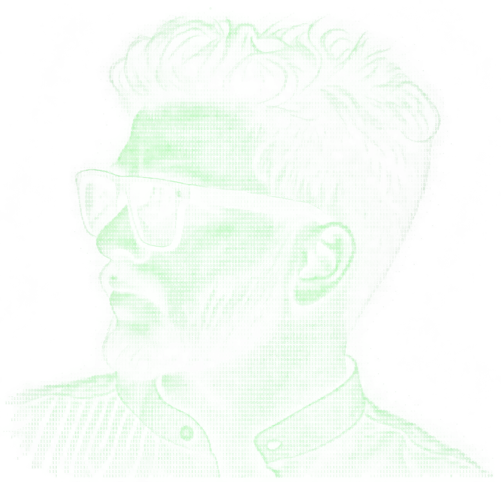

<div align="center">

# `NIJOY-P-JOSE // TERMINAL`



[](https://github.com/NIJOY-P-JOSE)

<a href="https://www.linkedin.com/in/nijoy-p-jose/"></a>
<a href="mailto:nijoypjose@gmail.com"></a>
<a href="https://leetcode.com/u/Nijoy/"></a>


</div>

---

## `> whoami`

Final-year CSE student at VAST, Thrissur (KTU), who started in computer hardware and moved into full-stack, AI and security. I like taking an idea from architecture to a working system.

```yaml
education : B.Tech CSE (lateral entry) · Diploma in Computer Hardware Engg · May 2027
focus     : Full-Stack · AI / LLM Systems · Agentic AI · Cybersecurity
building  : AegisSys · MutualFund
learning  : Cybersecurity · System Design · DSA
```

---

## `> projects`

| Project | What it does | Stack |
|---|---|---|
| 🛡️ **[AegisSys](https://github.com/NIJOY-P-JOSE/AegisSys)** | Explainable multi-agent AI for cybersecurity assessment, with human approval before remediation | `LangGraph` `Ollama` `RAG` |
| 💰 **MutualFund** | Mutual fund analysis and portfolio tracking | `Python` `AI Agents` |
| ⚙️ **[Event Approval](https://github.com/NIJOY-P-JOSE/event-approval-system)** | Multi-stage institutional approval workflow with roles and JWT | `Next.js` `Django` `DRF` |
| 🚆 **[OptiRail](https://github.com/NIJOY-P-JOSE/OptiRail)** | Train induction and scheduling decision-support for Kochi Metro | `Django` `PostgreSQL` `Docker` |
| 🎓 **[VidyaVault](https://github.com/NIJOY-P-JOSE/VidyaVault)** | Academic project repository with a Gemini-powered Q&A assistant | `Django` `Vertex AI` |
| 🤖 **[Beard Wizard](https://github.com/NIJOY-P-JOSE/beard-wizard)** | Real-time webcam beard-trimming guides | `OpenCV` `MediaPipe` |

<sub>More on my [repositories](https://github.com/NIJOY-P-JOSE?tab=repositories) page, including the VR Telepresence Robot (ESP32, MPU6050, Flask).</sub>

---

## `> stack`

<div align="center">


<br/>


</div>

---

## `> live stats`

<div align="center">


</div>

---

<div align="center">

🏆 **90+** LeetCode problems &nbsp;·&nbsp; 🥈 **2nd Prize**, Web Designing &nbsp;·&nbsp; 🚀 SIH · Stride &nbsp;·&nbsp; 📜 EY · Microsoft · NPTEL

`> next_target: build better systems, not just more systems.`

</div>
